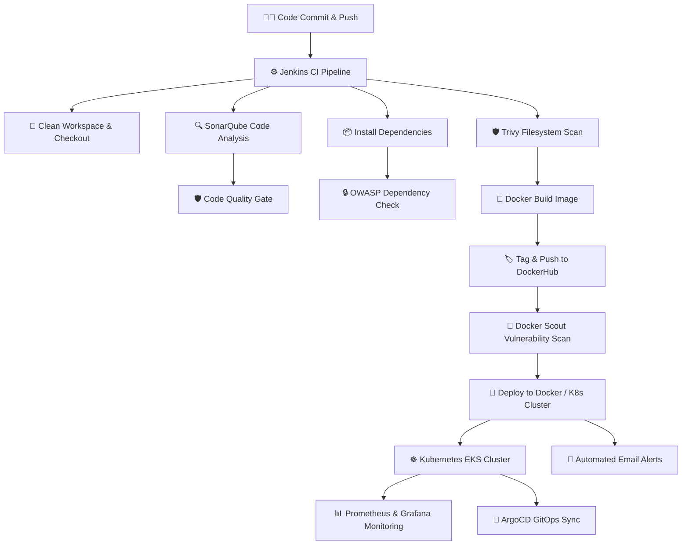

# 🍽️ Zomato Clone — End-to-End DevSecOps Pipeline & Kubernetes Deployment

A full-stack food delivery web application (Zomato Clone) packaged and deployed using an enterprise-grade **DevSecOps CI/CD pipeline**, containerized with **Docker**, orchestrated on **Kubernetes (AWS EKS)**, monitored with **Prometheus & Grafana**, and continuously delivered via **ArgoCD**.

---

## 📌 Architecture & Workflow



---

## 🛠️ Tech Stack & DevOps Tooling

| Domain | Technologies / Tools |
|---|---|
| **Frontend Application** | React 18, Material UI (MUI), Sass (SCSS), Web Vitals |
| **Containerization** | Docker, Dockerfile (Node 16 slim multi-stage) |
| **Continuous Integration** | Jenkins (Declarative Pipeline with JDK 17 & Node 23) |
| **Static Code Analysis** | SonarQube Scanner & Sonar Quality Gates |
| **Security & Vulnerability Scanning** | OWASP Dependency-Check, Trivy (FS scan), Docker Scout |
| **Container Registry** | DockerHub |
| **Container Orchestration** | Kubernetes, AWS EKS, `kubectl`, `eksctl` |
| **Continuous Delivery / GitOps** | ArgoCD |
| **Monitoring & Observability** | Prometheus, Node Exporter, Grafana |
| **Infrastructure & Cloud** | AWS (EC2 Ubuntu 24.04, EKS, CloudFormation) |

---

## 🚀 What Was Implemented

### 1. 🎨 Frontend Application (React & Sass)
- Developed a responsive **Zomato landing clone** featuring:
  - Dynamic navigation header with location picker and search functionality.
  - Category cards for delivery, dining out, and nightlife experiences.
  - Curated dining collection showcases and locality explorer grid.
  - Interactive FAQ accordion sections with expandable question cards.
  - App download CTA banner linking to Google Play and Apple App Store.
  - Modular Sass architecture with dedicated component styles and responsive breakpoints.

### 2. 🐳 Containerization (Docker)
- Authored an optimized [Dockerfile](file:///d:/DevOps-Project-Zomato/Dockerfile) utilizing `node:16-slim` as the base image.
- Implemented efficient layer caching by copying `package.json` and `package-lock.json` before application source code.
- Production build compilation using `npm run build` with application served on port `3000`.

### 3. ⚙️ Jenkins CI/CD & DevSecOps Pipeline
Built a robust declarative [jenkinsfile](file:///d:/DevOps-Project-Zomato/jenkinsfile) covering the complete software delivery lifecycle:
- **Clean Workspace & SCM Checkout**: Automatically sanitizes previous build artifacts and fetches the latest codebase.
- **SonarQube Static Analysis**: Scans source code for code smells, bugs, and duplications.
- **SonarQube Quality Gate**: Pipeline enforces quality standards and halts execution if quality criteria fail.
- **OWASP Dependency-Check**: Performs Software Composition Analysis (SCA) to detect known CVEs in third-party npm packages.
- **Trivy Vulnerability Scanner**: Executes deep filesystem scans for misconfigurations and security risks, publishing `trivy.txt` reports.
- **Docker Build & Push**: Builds the container image, tags it with proper versioning, and pushes to DockerHub securely via credentials store.
- **Docker Scout Security Analysis**: Runs image quickview, CVE analysis, and actionable remediation recommendations.
- **Automated Deployment**: Spins up the containerized application on target environment.
- **Post-Build Email Notifications**: Transmits HTML summary emails with build status, job metadata, and attached Trivy scan reports upon completion.

### 4. ☸️ Kubernetes (AWS EKS) Orchestration
- Created declarative Kubernetes manifests under [Kubernetes/](file:///d:/DevOps-Project-Zomato/Kubernetes):
  - **Deployment** ([deployment.yaml](file:///d:/DevOps-Project-Zomato/Kubernetes/deployment.yaml)): Manages 2 pod replicas of the Zomato application with automated rollout and restart policies.
  - **Application Service** ([service.yaml](file:///d:/DevOps-Project-Zomato/Kubernetes/service.yaml)): Exposes the application using a `NodePort` service mapped to port `30001` (targetPort `3000`).
  - **Node Exporter Service** ([node-service.yaml](file:///d:/DevOps-Project-Zomato/Kubernetes/node-service.yaml)): Configures the metric exporter service on port `9100` within the `prometheus-node-exporter` namespace.

### 5. 📈 Monitoring, Observability & GitOps
- **Prometheus & Grafana**: Deployed Prometheus Node Exporter via Helm to collect system and host-level metrics. Configured scrape jobs targeting cluster nodes on port `9100`.
- **ArgoCD**: Implemented GitOps continuous delivery by deploying ArgoCD server with LoadBalancer ingress, synchronizing Kubernetes cluster state directly with Git.

---

## 📂 Project Directory Structure

```text
DevOps-Project-Zomato/
├── .gitignore                      # Git ignore configuration
├── Command.txt                     # Comprehensive DevSecOps deployment runbook
├── Dockerfile                      # Node.js containerization specifications
├── jenkinsfile                     # Multi-stage DevSecOps CI/CD pipeline
├── package.json                    # Application metadata and dependencies
├── package-lock.json               # Deterministic dependency lockfile
├── public/                         # Static assets, HTML template, favicon & manifest
│   ├── favicon.ico
│   ├── index.html
│   └── manifest.json
├── src/                            # Application source code
│   ├── App.js                      # Root application component
│   ├── app.scss                    # Global layout styling
│   ├── data.js                     # Mock restaurant, locality, and FAQ datasets
│   ├── index.js                    # React DOM entry point
│   ├── assets/images/              # Application graphics, banners, and logos
│   └── components/                 # Modular React UI components
│       ├── Header/                 # Navigation bar and hero search
│       ├── Card/                   # Category experience cards
│       ├── Collections/            # Curated dining collection carousel
│       ├── Cities/                 # Popular localities explorer
│       ├── Accordian/              # Expandable FAQ items
│       ├── AccContainer/           # FAQ section container
│       ├── CTA/                    # Mobile app download section
│       └── Footer/                 # Footer links and social indicators
└── Kubernetes/                     # Kubernetes deployment configurations
    ├── deployment.yaml             # App deployment manifest (2 replicas)
    ├── service.yaml                # App NodePort service (port 30001)
    └── node-service.yaml           # Prometheus Node Exporter service
```

---

## 🚦 Getting Started

### Local Development (Frontend)

1. **Clone the repository:**
   ```bash
   git clone <repo-url>
   cd DevOps-Project-Zomato
   ```

2. **Install dependencies:**
   ```bash
   npm install
   ```

3. **Start local development server:**
   ```bash
   npm start
   ```
   The application will be accessible at `http://localhost:3000`.

---

### Running via Docker

1. **Build the Docker image:**
   ```bash
   docker build -t zomato:latest .
   ```

2. **Run the container:**
   ```bash
   docker run -d --name zomato -p 3000:3000 zomato:latest
   ```

3. Open your browser and navigate to `http://localhost:3000`.

---

### Kubernetes Deployment (EKS)

1. **Apply deployment and service manifests:**
   ```bash
   kubectl apply -f Kubernetes/deployment.yaml
   kubectl apply -f Kubernetes/service.yaml
   ```

2. **Verify pods and services:**
   ```bash
   kubectl get pods -l app=zomato
   kubectl get svc zomato
   ```

3. **Access application:**
   Access the application via your cluster node's IP address on port `30001`:
   ```text
   http://<NODE_PUBLIC_IP>:30001
   ```

---

## 🔒 Security Best Practices Implemented

- **Static Analysis (SAST)**: SonarQube ensures adherence to code cleanliness and security guidelines before artifact creation.
- **Dependency Scanning (SCA)**: OWASP checks identify vulnerable dependencies before packaging.
- **Image Scanning**: Trivy and Docker Scout verify that base image vulnerabilities and package CVEs are caught prior to registry publishing.
- **Least-Privilege Isolation**: Minimal Node slim image reduces the attack surface by eliminating unnecessary binaries and utilities.
- **Automated Quality Gates**: Builds automatically fail if critical security vulnerabilities or failing quality thresholds are detected.

---

## 📝 License & Acknowledgments

This project is open-source and intended for learning, demonstration, and production-grade DevSecOps practice.
